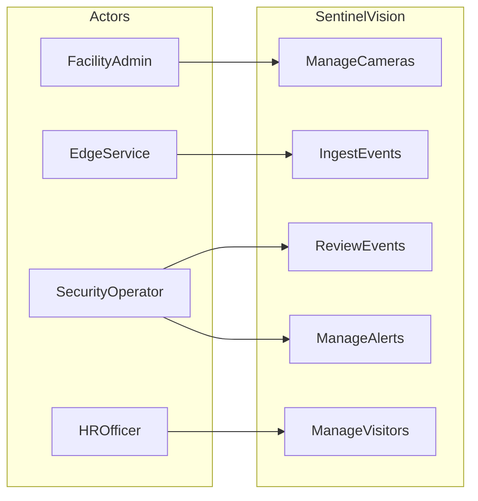
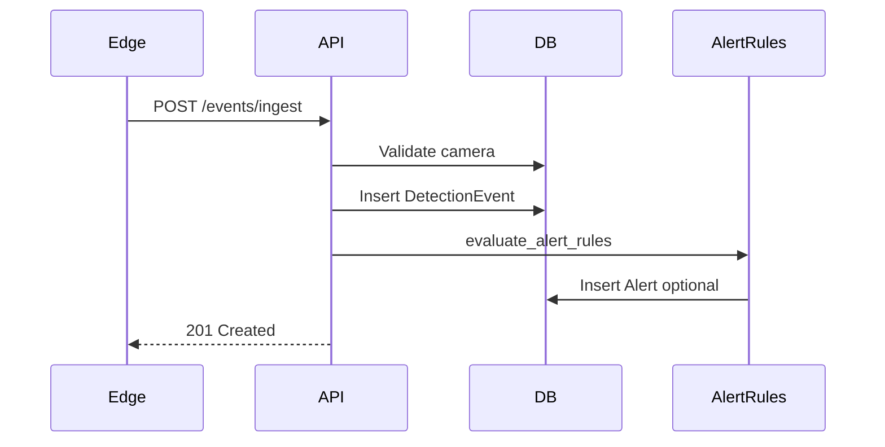

# Software Requirements Specification

> **SentinelVision AI — Enterprise Documentation Suite**
> Status legend: Implemented | Planned | Future


## 1. System Overview

SentinelVision AI comprises an edge inference worker, Django REST control plane, React dashboard, PostgreSQL datastore, and planned async/observability services.

### 1.1 Actors

| Actor | Description |
|-------|-------------|
| SecurityOperator | Monitors alerts and reviews events |
| FacilityAdmin | Configures cameras, sites, users |
| HROfficer | Manages attendance and visitors |
| EdgeService | Automated edge worker posting heartbeats/events |
| SystemAuditor | Reviews audit and compliance exports |
| PlatformAdmin | Operates control plane infrastructure |

## 2. Use Cases

| ID | Use Case | Primary Actor | Status |
|----|----------|---------------|--------|
| UC-AUTH-01 | Authenticate with JWT | All users | Implemented |
| UC-CAM-01 | Register camera | FacilityAdmin | Implemented |
| UC-EDGE-01 | Edge heartbeat registration | EdgeService | Implemented |
| UC-EVT-01 | Ingest detection event | EdgeService | Implemented |
| UC-EVT-02 | Review detection event | SecurityOperator | Implemented |
| UC-ALERT-01 | Acknowledge alert | SecurityOperator | Implemented |
| UC-ALERT-02 | Configure alert rule | FacilityAdmin | Implemented |
| UC-ATT-01 | Record attendance via face | EdgeService | Planned |
| UC-VIS-01 | Pre-register visitor | HROfficer | Planned |
| UC-RPT-01 | Export incident report | SystemAuditor | Planned |

### UC-EVT-01 Ingest Detection Event

**Preconditions:** Edge device authenticated; camera active.

**Main flow:**
1. Edge samples inference result.
2. Edge POSTs event payload to `/api/v1/events/ingest/`.
3. API validates camera ownership/site binding.
4. API persists DetectionEvent.
5. API evaluates alert rules and creates Alert records when matched.

**Alternate flows:**
- A1: Duplicate `edge_event_id` returns existing event (200).
- A2: Invalid camera returns 404.
- A3: Camera outside edge site returns 403.

**Postconditions:** Event stored; optional alert created.

### UC-EVT-02 Review Detection Event

**Preconditions:** Operator authenticated with Operator+ role.

**Main flow:**
1. Operator opens event review queue.
2. Operator selects pending event.
3. Operator marks confirmed or false positive.
4. System records reviewer and timestamp.

## 3. UML Use Case Diagram



## 4. Activity Diagram — Event Processing

1. Edge captures frame
2. Detector produces candidates
3. Module router evaluates zones/rules
4. Event payload assembled
5. HTTP POST with retry
6. API validation
7. Persist event
8. Evaluate alert rules
9. Dashboard refresh

## 5. Sequence Diagram — Event Ingestion



## 6. State Diagram — Alert Lifecycle

| State | Description |
|-------|-------------|
| open | Created, awaiting operator action |
| acknowledged | Operator acknowledged |
| resolved | Incident closed |
| dismissed | False alarm or non-actionable |

Transitions: open→acknowledged (operator), acknowledged→resolved (operator), open→dismissed (operator/admin).

## 7. Business Rules

| ID | Rule |
|----|------|
| BR-TEN-01 | All user queries must be scoped to member organizations |
| BR-RBAC-01 | Viewer cannot mutate configuration |
| BR-EDGE-01 | Edge may ingest only for cameras on its site |
| BR-ALERT-01 | Alert severity must be >= rule min severity |
| BR-ALERT-02 | Event confidence must be >= rule min confidence |
| BR-BIO-01 | Face enrollment requires consent record (Planned) |
| BR-RET-01 | Evidence retention defaults to 30 days (Planned enforcement) |

## 8. Validation Rules

| Entity | Field | Validation |
|--------|-------|------------|
| Camera | name | Required, unique per site |
| Camera | rtsp_url | Valid URL format |
| Zone | polygon_json | Array of normalized [x,y] pairs |
| DetectionEvent | confidence | 0.0–1.0 |
| AlertRule | min_confidence | 0.0–1.0 |
| EdgeDevice | api_key | One-time display on create |

## 9. Error Handling

| Code | Condition | Response |
|------|-----------|----------|
| 400 | Serializer validation failure | DRF validation errors |
| 401 | Missing/invalid JWT or edge key | Authentication failed |
| 403 | Role or site mismatch | Permission denied |
| 404 | Resource not found | Not found |
| 409 | Planned idempotency conflict | Future standardized envelope |

**Target error envelope (Planned):**

```json
{"error": {"code": "VALIDATION_ERROR", "message": "...", "details": {}}}
```

## 10. Workflow Specifications

### 10.1 Human Review Workflow

Pending → Confirmed | False Positive | Escalated

Escalated events require supervisor review (Planned).

### 10.2 Edge Offline Workflow

1. Heartbeat missed beyond threshold
2. Edge marked offline (Planned automated rule)
3. Cameras at site marked degraded
4. Operator notification (Planned)

## 11. Security Requirements

- JWT access token 15 minutes; refresh 7 days
- Edge API keys stored hashed (SHA-256)
- Tenant isolation on all list/detail endpoints
- Planned: rate limiting, key rotation, constant-time compare

## 12. Traceability

Each UC maps to FR IDs in Volume 1 and API IDs in Volume 5.
