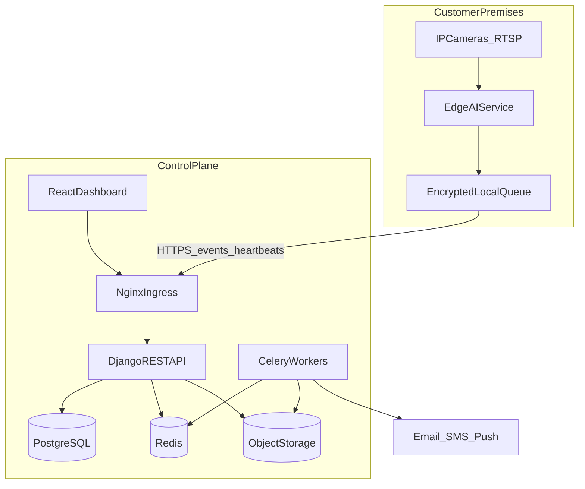
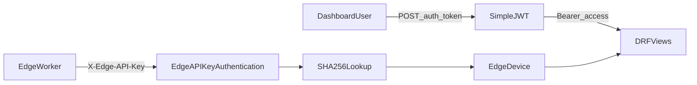
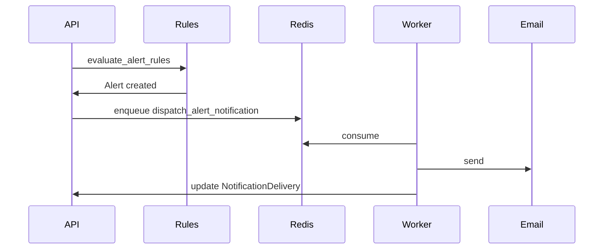
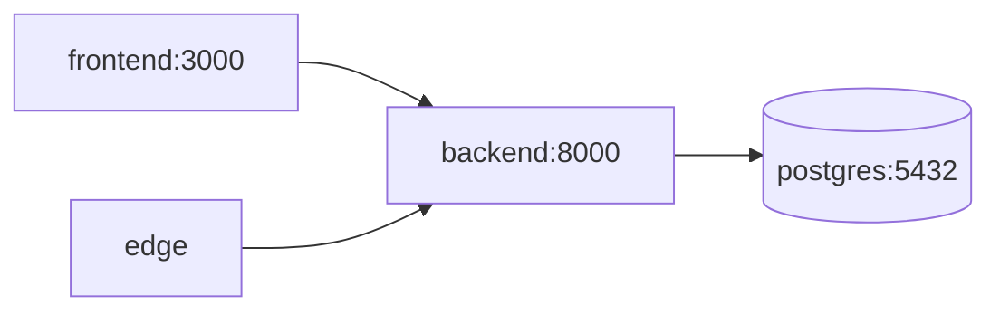
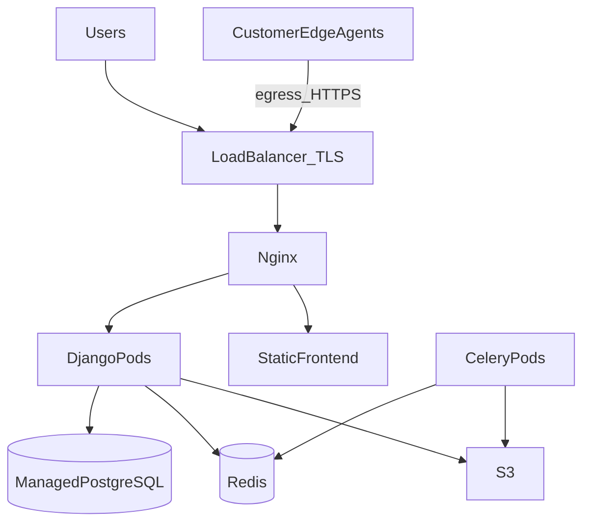

# System Design Document

> **SentinelVision AI — Volume 3**
> Status: Implemented | Planned | Future

## 1. Document Control

| Field | Value |
|-------|-------|
| Document ID | DOC-SDD-003 |
| Version | 2.0.0 |
| Status | Engineering Ready |
| Architecture style | Modular monolith + edge worker → evolutionary services |
| Deployment model | Hybrid (edge inference, central control plane) |

## 2. Goals and Non-Goals

### 2.1 Goals

- Clear blueprint for M2–M6 engineering
- Separate current MVP from target production architecture
- Define RTSP → YOLO → event → alert → storage data path
- Specify Celery/Redis/object storage integration points

### 2.2 Non-Goals

- Not a full VMS replacement
- Not claiming production AI accuracy in current edge simulation
- Not requiring microservices for M1–M2

## 3. Current vs Target Architecture

| Layer | Current (M0/M1) | Target (M2–M6) |
|-------|-----------------|----------------|
| Control plane | Django modular monolith | Same core + extracted workers |
| Edge | Simulated detector + HTTP | RTSP + OpenCV + YOLO + queue |
| DB | PostgreSQL / SQLite | PostgreSQL HA |
| Jobs | Inline alert evaluation | Celery + Redis |
| Storage | None for media | S3-compatible evidence |
| Ingress | Compose Nginx | Nginx/Ingress + TLS |
| Orchestration | Docker Compose | Kubernetes (prod) |
| Observability | Health endpoint | Prometheus/Grafana/ELK |

---

## 4. High-Level Architecture



### 4.1 Trust Boundaries

| Zone | Trust | Network |
|------|-------|---------|
| Camera LAN | High trust internal | RTSP only to edge |
| Edge host | Semi-trusted | Outbound HTTPS 443 only |
| Control plane private | Trusted | DB/Redis not public |
| Public internet | Untrusted | TLS to Nginx only |

---

## 5. Django App Architecture (Implemented)

### 5.1 Project Layout

```
backend/
  config/                 # settings, urls, wsgi/asgi
  apps/
    common/               # UUIDModel, TimestampedModel, TenantQuerysetMixin
    tenancy/              # Organization, UserMembership, roles
    sites/                # Site, Zone
    cameras/              # Camera, EdgeDevice, EdgeAPIKeyAuthentication
    events/               # DetectionEvent, ingest, review, dashboard, health
    alerts/               # AlertRule, Alert, evaluate_alert_rules
    audit/                # AuditLog, middleware, log_audit helper
```

### 5.2 App Responsibilities

| App | Responsibility | Key modules |
|-----|----------------|-------------|
| `config` | Django settings, URL mount, JWT/CORS/DRF | `settings.py`, `urls.py` |
| `common` | Shared base models and tenant mixin | `models.py`, `permissions.py` |
| `tenancy` | Multi-tenant orgs and RBAC membership | models, views, seed command |
| `sites` | Facilities and detection zones | Site/Zone CRUD |
| `cameras` | Camera registry, edge devices, edge auth | authentication, views |
| `events` | Event ingest, list, review, dashboard | serializers, views |
| `alerts` | Rules and alert lifecycle | `services.evaluate_alert_rules` |
| `audit` | Audit storage and list API | middleware context |

### 5.3 Request Processing Pipeline

```
Client
  -> SecurityMiddleware
  -> CorsMiddleware
  -> Session/Common/Csrf
  -> AuthenticationMiddleware (Django session)
  -> AuditContextMiddleware
  -> DRF authentication (JWT or EdgeAPIKey)
  -> Permission classes
  -> TenantQuerysetMixin scoping
  -> Serializer validation
  -> ORM / service layer
  -> JSON response
```

### 5.4 Authentication Architecture



| Principal | Auth class | Bound context |
|-----------|------------|---------------|
| Human user | `JWTAuthentication` | `request.user` + memberships |
| Edge device | `EdgeAPIKeyAuthentication` | `EdgeServiceUser` + optional `device` |

### 5.5 Tenancy Isolation Pattern

```python
# Conceptual (implemented in TenantQuerysetMixin)
org_ids = UserMembership.objects.filter(user=request.user).values_list("organization_id")
queryset = Model.objects.filter(organization_id__in=org_ids)
# or via joins: camera__site__organization_id__in=org_ids
```

**Write guards:** `require_role(user, org, [OWNER, ADMIN, ...])` before create/update/delete.

### 5.6 Domain Event Path (Current)

```
Edge.detect()
  -> POST /api/v1/events/ingest/
  -> EventIngestView validates camera + site binding
  -> DetectionEvent.objects.create(...)
  -> evaluate_alert_rules(event)
  -> optional Alert.objects.create(...)
  -> Dashboard/Alerts UI poll lists
```

---

## 6. Evolutionary Microservices Plan

Do **not** split for M1–M2. Extract only when boundaries are stable.

| Stage | Architecture |
|-------|--------------|
| M0–M2 | Modular monolith + edge |
| M3 | Optional `notification-service` (Celery first is enough) |
| M4 | `report-service` worker; evidence uploader |
| M5–M6 | Optional `inference-coordinator` for multi-site fleets |

### 6.1 Candidate Service Boundaries (Future)

| Service | Owns | Talks to |
|---------|------|----------|
| control-api | Tenancy, cameras, events, alerts | PG, Redis, S3 |
| edge-agent | Streams, inference | Cameras, control-api |
| notify-worker | Delivery attempts | Redis, email/SMS providers |
| report-worker | PDF/CSV generation | PG, S3 |
| media-gateway | Signed URLs, retention | S3 |

**Communication:** sync REST for control; async queue for notifications/reports; never share DB writes across services without clear ownership.

---

## 7. Redis Design (Planned — M3+)

### 7.1 Roles

| Use | Key pattern | TTL |
|-----|-------------|-----|
| Celery broker | Celery internal | — |
| Celery result backend | Celery internal | short |
| JWT refresh blacklist | `jwt:bl:{jti}` | refresh remaining life |
| Rate limit counters | `rl:{principal}:{window}` | 60s |
| Dashboard cache | `dash:{org_id}:summary` | 5–15s |
| Edge online set | `edge:online:{site_id}` | heartbeat TTL |

### 7.2 Django Settings Sketch

```python
CELERY_BROKER_URL = "redis://redis:6379/0"
CELERY_RESULT_BACKEND = "redis://redis:6379/1"
CACHES = {
  "default": {
    "BACKEND": "django.core.cache.backends.redis.RedisCache",
    "LOCATION": "redis://redis:6379/2",
  }
}
```

---

## 8. Celery Queues (Planned)

### 8.1 Queue Map

| Queue | Priority | Tasks |
|-------|----------|-------|
| `notifications` | High | email/SMS/push for critical alerts |
| `reports` | Normal | scheduled and on-demand exports |
| `retention` | Low | delete expired events/evidence |
| `media` | Normal | thumbnail/clip packaging to S3 |
| `default` | Normal | misc maintenance |

### 8.2 Task Catalog

| Task | Trigger | Input | Side effects |
|------|---------|-------|--------------|
| `dispatch_alert_notification` | Alert create (critical/warning) | alert_id | NotificationDelivery rows |
| `generate_incident_report` | API or schedule | org_id, range | PDF in S3 + email link |
| `purge_expired_events` | Nightly | retention policy | Soft/hard delete + audit |
| `purge_expired_evidence` | Nightly | retention_until | S3 delete |
| `recompute_dashboard_cache` | Event ingest debounce | org_id | Redis set |

### 8.3 Worker Deployment

```
celery -A config worker -Q notifications,reports,retention,media,default -c 4
celery -A config beat -l INFO
```

### 8.4 Alert Notification Flow (Target)



---

## 9. Object Storage Flow (Planned)

### 9.1 Buckets

| Bucket | Contents | Access |
|--------|----------|--------|
| `sv-evidence` | Snapshots/clips | Private; signed GET |
| `sv-reports` | PDF/CSV exports | Private; signed GET |
| `sv-models` | Edge model packages | Private; edge pull with key |

### 9.2 Evidence Upload Path

```
Edge captures JPEG/clip on alert-worthy event
  -> optional local encrypt
  -> POST multipart or pre-signed PUT
  -> control plane stores EvidenceArtifact(storage_key, retention_until)
  -> UI requests signed URL via API-EVIDENCE-GET
```

**Policy:** Raw continuous video stays on-prem by default. Only event-linked clips leave the site.

---

## 10. RTSP Processing Pipeline (M2 Target)

### 10.1 Pipeline Stages

```
RTSP URL
  -> OpenCV VideoCapture / GStreamer
  -> FrameSampler (every Nth frame or time-based)
  -> YOLO person/object detect
  -> Tracker (ByteTrack) assign track_id
  -> ModuleRouter (per camera.enabled_modules)
      -> Intrusion (zone polygon test)
      -> Face (InsightFace) M3
      -> Fire/Smoke/Weapon M5
  -> EventBuilder (confidence, bbox, model meta)
  -> LocalQueue (retry buffer)
  -> HTTPS POST /events/ingest/
  -> Heartbeat loop (parallel)
```

### 10.2 Edge Service Components

| Component | File (current) | M2 change |
|-----------|----------------|-----------|
| Config | `edge/edge_service/config.py` | Add RTSP list, FPS, GPU flags |
| Client | `edge/edge_service/client.py` | Keep retry ingest/heartbeat |
| Inference | `edge/edge_service/inference.py` | Replace SimulatedYOLO with YOLO |
| Stream | OpenCVStreamAdapter (exists, unused) | Wire into main loop |
| Main | `edge/edge_service/main.py` | Per-camera worker threads/async |

### 10.3 Frame Sampling Policy

| Mode | Rule | Use |
|------|------|-----|
| Baseline | 5–10 FPS decode, infer 2–5 FPS | Person tracking |
| Alert boost | Temporary 10–15 FPS for 10s after event | Evidence quality |
| Degraded | Drop to 1 FPS on GPU overload | Stability |

### 10.4 Zone Intrusion Logic

```
for detection in persons:
  centroid = bbox_center_normalized(detection.bbox)
  if point_in_polygon(centroid, zone.polygon_json) and zone.is_restricted:
    if schedule_active(now, zone.schedule):  # Planned schedule
      emit event_type=intrusion severity=critical|warning
```

### 10.5 Failure Handling

| Failure | Behavior |
|---------|----------|
| RTSP disconnect | Exponential reconnect; camera status error |
| API 5xx | Local queue retry with backoff |
| GPU OOM | Reduce batch/FPS; emit edge health warning |
| Disk queue full | Drop lowest severity; log critical ops alert |

### 10.6 Current Simulation Path (Implemented)

```
Timer every SIMULATION_INTERVAL
  -> SimulatedYOLODetector.detect()  # random person_detected
  -> build_event_payload(camera_id, detection)
  -> ControlPlaneClient.ingest_event
```

This validates control-plane contracts only — not production security.

---

## 11. Deployment Architecture

### 11.1 Local Docker Compose (Implemented)



| Service | Image role | Port |
|---------|------------|------|
| db | postgres:15-alpine | 5432 |
| backend | Django/Gunicorn | 8000 |
| frontend | Nginx + React build | 3000 |
| edge | Python edge worker | — |

Healthchecks: Postgres `pg_isready`; backend HTTP `/api/v1/health/`.

### 11.2 Staging / Production (Planned)



### 11.3 Kubernetes Workloads (Planned)

| Workload | Replicas | Notes |
|----------|----------|-------|
| `api` Deployment | 2–N | HPA on CPU / RPS |
| `worker` Deployment | 1–N | One deployment per queue group optional |
| `beat` Deployment | 1 | Singleton |
| `frontend` Deployment | 2 | CDN preferred |
| Ingress | 1 | cert-manager TLS |
| NetworkPolicy | — | Deny DB from non-api |

### 11.4 Environment Matrix

| Env | Compose | K8s | Real cameras | Secrets |
|-----|---------|-----|--------------|---------|
| Local | Yes | No | Optional | `.env` |
| CI | Ephemeral | No | No | GHA secrets |
| Staging | Optional | Yes | Lab RTSP | Vault/ESO |
| Production | No | Yes | Customer | Vault/ESO |

### 11.5 Nginx Responsibilities

| Path | Upstream |
|------|----------|
| `/` | Frontend static |
| `/api/` | Django API |
| `/api/docs/` | Spectacular Swagger |
| `/healthz` | Local Nginx health |

Production adds: TLS, HSTS, request size limits, edge ingest rate limits.

---

## 12. Monitoring and Logging (Target)

| Signal | Tool | Alert example |
|--------|------|---------------|
| API latency/error rate | Prometheus + Grafana | p95 > 1s or 5xx > 1% |
| Celery queue depth | Redis metrics | notifications depth > 1000 |
| Edge heartbeat age | Custom metric | last_seen > 2 min |
| Disk / GPU | Node exporter / DCGM | GPU mem > 90% |
| App logs | ELK/OpenSearch | ERROR spikes |
| Audit trail | Postgres audit_auditlog | Missing writes (integrity) |

**Current:** Only `GET /api/v1/health/` is Implemented.

---

## 13. Security Design Highlights

| Control | Status |
|---------|--------|
| JWT short-lived access tokens | Implemented |
| Edge key hashed at rest | Implemented |
| Tenant query scoping | Implemented |
| Role gates on writes | Implemented |
| TLS everywhere | Planned (prod) |
| Rate limiting | Planned |
| Constant-time key compare | Planned |
| Device-bound ingest only | Remediation required |
| Audit auto-logging | Remediation required |
| Secrets in Vault | Planned |

---

## 14. Capacity Model

### 14.1 Edge Node Sizing

| Profile | Cameras | GPU | Concurrent modules |
|---------|---------|-----|--------------------|
| Small | 4 | Jetson Orin Nano | detection + tracking |
| Medium | 8–12 | RTX 3060 | + face |
| Large | 12–16 | RTX 4070+ | + threat modules |

### 14.2 Control Plane Sizing (per 100 sites / 1k cameras)

| Component | Baseline |
|-----------|----------|
| API pods | 4 × 2 vCPU / 4 GB |
| Workers | 2 × 2 vCPU / 4 GB |
| PostgreSQL | 8 vCPU / 32 GB / SSD |
| Redis | 2 GB |
| Object storage | Elastic |

---

## 15. Development Sequence Mapping

| Milestone | System design focus |
|-----------|---------------------|
| M1 | Django apps, JWT, RBAC, tenancy, dashboard APIs — **Implemented** |
| M2 | RTSP, OpenCV, YOLO, tracker, real ingest, zone intrusion |
| M3 | InsightFace, enrollment, attendance tables + APIs |
| M4 | Unknown person, visitors, intrusion hardening |
| M5 | Fire/smoke/weapon models + critical notification path |
| M6 | Reports, Celery notifications, mobile/PWA, analytics |

---

## 16. Engineering Checklists

### 16.1 Before M2 Coding Starts

- [ ] Camera has valid RTSP and enabled_modules
- [ ] Edge device registered; API key stored on node
- [ ] Alert rules for `person_detected` / `intrusion` seeded
- [ ] Volume 4 integrity triggers scheduled (DB-FIX-*)
- [ ] Volume 5 ingest contract tests green

### 16.2 Definition of Done — M2 Vertical Slice

- [ ] One live RTSP stream decoded on edge
- [ ] YOLO detections produce real events (not random)
- [ ] Track IDs stable across frames for short windows
- [ ] Restricted zone intrusion creates critical alert
- [ ] Operator reviews event and acknowledges alert in UI

---

## 17. Traceability

| Design Area | Volumes | Status |
|-------------|---------|--------|
| Django apps | Vol 4, Vol 5 | Implemented |
| Edge pipeline | Vol 6 AI | Partial / M2 |
| Celery/Redis | Vol 8 DevOps | Planned |
| Storage | Vol 4 Evidence | Planned |
| Deployment | Vol 8 | Compose Implemented; K8s Planned |
