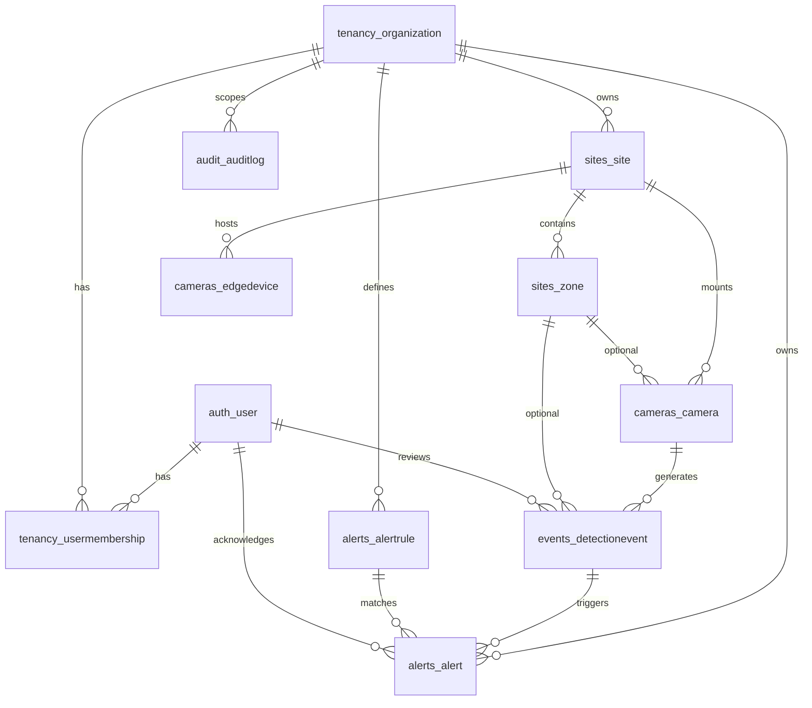

# Database Design

> **SentinelVision AI — Volume 4**
> Status: Implemented | Planned | Future

## 1. Document Control

| Field | Value |
|-------|-------|
| Document ID | DOC-DB-004 |
| Version | 2.0.0 |
| Status | Engineering Ready |
| Primary RDBMS | PostgreSQL 15+ |
| Local fallback | SQLite (dev only) |
| ORM | Django 5.x migrations |

## 2. Design Principles

1. UUID primary keys for all domain tables (API-stable identifiers).
2. Tenant isolation via `organization_id` or join through `site → organization`.
3. Soft operational flags (`is_active`) preferred over hard deletes for config entities.
4. JSONB for flexible metadata/payloads; typed columns for queryable fields.
5. Indexes for time-series event/alert queries.
6. Additive migrations only in production without approved downtime window.

## 3. Logical ER Diagram



## 4. Schema Overview (Implemented)

| Django App | Table | Model |
|------------|-------|-------|
| tenancy | `tenancy_organization` | Organization |
| tenancy | `tenancy_usermembership` | UserMembership |
| sites | `sites_site` | Site |
| sites | `sites_zone` | Zone |
| cameras | `cameras_camera` | Camera |
| cameras | `cameras_edgedevice` | EdgeDevice |
| events | `events_detectionevent` | DetectionEvent |
| alerts | `alerts_alertrule` | AlertRule |
| alerts | `alerts_alert` | Alert |
| audit | `audit_auditlog` | AuditLog |

Django also uses `auth_user`, `auth_group`, `django_session`, `django_migrations`, etc.

---

## 5. DDL — Implemented Tables (PostgreSQL)

> Generated to match current Django models. Apply via `python manage.py migrate` in production; DDL below is the engineering reference.

### 5.1 tenancy_organization

```sql
CREATE TABLE tenancy_organization (
    id              UUID PRIMARY KEY,
    name            VARCHAR(255) NOT NULL,
    slug            VARCHAR(100) NOT NULL,
    settings        JSONB NOT NULL DEFAULT '{}'::jsonb,
    is_active       BOOLEAN NOT NULL DEFAULT TRUE,
    created_at      TIMESTAMPTZ NOT NULL,
    updated_at      TIMESTAMPTZ NOT NULL,
    CONSTRAINT tenancy_organization_slug_key UNIQUE (slug)
);

CREATE INDEX tenancy_organization_slug_like
    ON tenancy_organization (slug varchar_pattern_ops);
```

| Column | Type | Null | Default | Notes |
|--------|------|------|---------|-------|
| id | UUID | NO | uuid4 | PK |
| name | VARCHAR(255) | NO | — | Display name |
| slug | VARCHAR(100) | NO | — | Unique URL/key |
| settings | JSONB | NO | `{}` | Retention, feature flags |
| is_active | BOOLEAN | NO | TRUE | Soft disable |
| created_at | TIMESTAMPTZ | NO | now | |
| updated_at | TIMESTAMPTZ | NO | now | |

### 5.2 tenancy_usermembership

```sql
CREATE TABLE tenancy_usermembership (
    id              UUID PRIMARY KEY,
    role            VARCHAR(20) NOT NULL DEFAULT 'viewer',
    created_at      TIMESTAMPTZ NOT NULL,
    updated_at      TIMESTAMPTZ NOT NULL,
    organization_id UUID NOT NULL REFERENCES tenancy_organization(id) ON DELETE CASCADE,
    user_id         INTEGER NOT NULL REFERENCES auth_user(id) ON DELETE CASCADE,
    CONSTRAINT tenancy_usermembership_user_org_uniq UNIQUE (user_id, organization_id),
    CONSTRAINT tenancy_usermembership_role_chk CHECK (role IN ('owner','admin','operator','viewer'))
);

CREATE INDEX tenancy_usermembership_org_idx ON tenancy_usermembership (organization_id);
CREATE INDEX tenancy_usermembership_user_idx ON tenancy_usermembership (user_id);
```

### 5.3 sites_site

```sql
CREATE TABLE sites_site (
    id              UUID PRIMARY KEY,
    name            VARCHAR(255) NOT NULL,
    address         TEXT NOT NULL DEFAULT '',
    timezone        VARCHAR(64) NOT NULL DEFAULT 'UTC',
    is_active       BOOLEAN NOT NULL DEFAULT TRUE,
    created_at      TIMESTAMPTZ NOT NULL,
    updated_at      TIMESTAMPTZ NOT NULL,
    organization_id UUID NOT NULL REFERENCES tenancy_organization(id) ON DELETE CASCADE,
    CONSTRAINT sites_site_org_name_uniq UNIQUE (organization_id, name)
);

CREATE INDEX sites_site_org_idx ON sites_site (organization_id);
```

### 5.4 sites_zone

```sql
CREATE TABLE sites_zone (
    id              UUID PRIMARY KEY,
    name            VARCHAR(255) NOT NULL,
    polygon_json    JSONB NOT NULL DEFAULT '[]'::jsonb,
    is_restricted   BOOLEAN NOT NULL DEFAULT FALSE,
    is_active       BOOLEAN NOT NULL DEFAULT TRUE,
    created_at      TIMESTAMPTZ NOT NULL,
    updated_at      TIMESTAMPTZ NOT NULL,
    site_id         UUID NOT NULL REFERENCES sites_site(id) ON DELETE CASCADE,
    CONSTRAINT sites_zone_site_name_uniq UNIQUE (site_id, name)
);

CREATE INDEX sites_zone_site_idx ON sites_zone (site_id);
```

**polygon_json example:**

```json
[[0.1, 0.1], [0.9, 0.1], [0.9, 0.9], [0.1, 0.9]]
```

Coordinates are normalized image fractions (0.0–1.0).

### 5.5 cameras_camera

```sql
CREATE TABLE cameras_camera (
    id              UUID PRIMARY KEY,
    name            VARCHAR(255) NOT NULL,
    rtsp_url        VARCHAR(512) NOT NULL DEFAULT '',
    status          VARCHAR(20) NOT NULL DEFAULT 'offline',
    enabled_modules JSONB NOT NULL DEFAULT '[]'::jsonb,
    last_seen_at    TIMESTAMPTZ NULL,
    metadata        JSONB NOT NULL DEFAULT '{}'::jsonb,
    is_active       BOOLEAN NOT NULL DEFAULT TRUE,
    created_at      TIMESTAMPTZ NOT NULL,
    updated_at      TIMESTAMPTZ NOT NULL,
    site_id         UUID NOT NULL REFERENCES sites_site(id) ON DELETE CASCADE,
    zone_id         UUID NULL REFERENCES sites_zone(id) ON DELETE SET NULL,
    CONSTRAINT cameras_camera_site_name_uniq UNIQUE (site_id, name),
    CONSTRAINT cameras_camera_status_chk CHECK (
        status IN ('online','offline','error','maintenance')
    )
);

CREATE INDEX cameras_camera_site_idx ON cameras_camera (site_id);
CREATE INDEX cameras_camera_zone_idx ON cameras_camera (zone_id);
CREATE INDEX cameras_camera_status_idx ON cameras_camera (status);
```

### 5.6 cameras_edgedevice

```sql
CREATE TABLE cameras_edgedevice (
    id              UUID PRIMARY KEY,
    name            VARCHAR(255) NOT NULL,
    api_key_hash    VARCHAR(128) NOT NULL,
    api_key_prefix  VARCHAR(8) NOT NULL DEFAULT '',
    last_seen_at    TIMESTAMPTZ NULL,
    status          VARCHAR(20) NOT NULL DEFAULT 'offline',
    version         VARCHAR(64) NOT NULL DEFAULT '',
    metadata        JSONB NOT NULL DEFAULT '{}'::jsonb,
    is_active       BOOLEAN NOT NULL DEFAULT TRUE,
    created_at      TIMESTAMPTZ NOT NULL,
    updated_at      TIMESTAMPTZ NOT NULL,
    site_id         UUID NOT NULL REFERENCES sites_site(id) ON DELETE CASCADE,
    CONSTRAINT cameras_edgedevice_site_name_uniq UNIQUE (site_id, name)
);

CREATE INDEX cameras_edgedevice_site_idx ON cameras_edgedevice (site_id);
CREATE UNIQUE INDEX cameras_edgedevice_api_key_hash_uniq ON cameras_edgedevice (api_key_hash);
CREATE INDEX cameras_edgedevice_last_seen_idx ON cameras_edgedevice (last_seen_at DESC);
```

**Security:** Never store plaintext API keys. Hash with SHA-256 before insert.

### 5.7 events_detectionevent

```sql
CREATE TABLE events_detectionevent (
    id              UUID PRIMARY KEY,
    event_type      VARCHAR(32) NOT NULL,
    severity        VARCHAR(16) NOT NULL DEFAULT 'info',
    confidence      DOUBLE PRECISION NOT NULL DEFAULT 0.0,
    model_name      VARCHAR(128) NOT NULL DEFAULT '',
    model_version   VARCHAR(64) NOT NULL DEFAULT '',
    payload         JSONB NOT NULL DEFAULT '{}'::jsonb,
    review_status   VARCHAR(20) NOT NULL DEFAULT 'pending',
    reviewed_at     TIMESTAMPTZ NULL,
    retention_until TIMESTAMPTZ NULL,
    edge_event_id   VARCHAR(128) NOT NULL DEFAULT '',
    created_at      TIMESTAMPTZ NOT NULL,
    updated_at      TIMESTAMPTZ NOT NULL,
    camera_id       UUID NOT NULL REFERENCES cameras_camera(id) ON DELETE CASCADE,
    zone_id         UUID NULL REFERENCES sites_zone(id) ON DELETE SET NULL,
    reviewed_by_id  INTEGER NULL REFERENCES auth_user(id) ON DELETE SET NULL,
    CONSTRAINT events_detectionevent_type_chk CHECK (
        event_type IN (
            'person_detected','face_recognized','unknown_person','intrusion',
            'activity','fire_smoke','weapon','attendance','visitor'
        )
    ),
    CONSTRAINT events_detectionevent_severity_chk CHECK (
        severity IN ('info','warning','critical')
    ),
    CONSTRAINT events_detectionevent_review_chk CHECK (
        review_status IN ('pending','confirmed','false_positive','escalated')
    ),
    CONSTRAINT events_detectionevent_confidence_chk CHECK (
        confidence >= 0.0 AND confidence <= 1.0
    )
);

CREATE INDEX events_detectionevent_camera_type_idx
    ON events_detectionevent (camera_id, event_type);
CREATE INDEX events_detectionevent_created_idx
    ON events_detectionevent (created_at DESC);
CREATE INDEX events_detectionevent_edge_event_id_idx
    ON events_detectionevent (edge_event_id);
CREATE INDEX events_detectionevent_review_idx
    ON events_detectionevent (review_status);
```

**Planned hardening indexes/constraints:**

```sql
-- Denormalized tenant key for faster isolation & idempotency
ALTER TABLE events_detectionevent
    ADD COLUMN organization_id UUID NULL REFERENCES tenancy_organization(id);

CREATE UNIQUE INDEX events_detectionevent_org_edge_uniq
    ON events_detectionevent (organization_id, edge_event_id)
    WHERE edge_event_id <> '';

CREATE INDEX events_detectionevent_org_created_idx
    ON events_detectionevent (organization_id, created_at DESC);
```

### 5.8 alerts_alertrule

```sql
CREATE TABLE alerts_alertrule (
    id              UUID PRIMARY KEY,
    name            VARCHAR(255) NOT NULL,
    event_type      VARCHAR(32) NOT NULL,
    min_severity    VARCHAR(16) NOT NULL DEFAULT 'warning',
    min_confidence  DOUBLE PRECISION NOT NULL DEFAULT 0.5,
    is_active       BOOLEAN NOT NULL DEFAULT TRUE,
    notify_email    BOOLEAN NOT NULL DEFAULT TRUE,
    conditions      JSONB NOT NULL DEFAULT '{}'::jsonb,
    created_at      TIMESTAMPTZ NOT NULL,
    updated_at      TIMESTAMPTZ NOT NULL,
    organization_id UUID NOT NULL REFERENCES tenancy_organization(id) ON DELETE CASCADE,
    CONSTRAINT alerts_alertrule_confidence_chk CHECK (
        min_confidence >= 0.0 AND min_confidence <= 1.0
    )
);

CREATE INDEX alerts_alertrule_org_idx ON alerts_alertrule (organization_id);
CREATE INDEX alerts_alertrule_type_active_idx
    ON alerts_alertrule (organization_id, event_type, is_active);
```

### 5.9 alerts_alert

```sql
CREATE TABLE alerts_alert (
    id                  UUID PRIMARY KEY,
    title               VARCHAR(512) NOT NULL,
    message             TEXT NOT NULL DEFAULT '',
    severity            VARCHAR(16) NOT NULL,
    status              VARCHAR(20) NOT NULL DEFAULT 'open',
    acknowledged_at     TIMESTAMPTZ NULL,
    resolved_at         TIMESTAMPTZ NULL,
    created_at          TIMESTAMPTZ NOT NULL,
    updated_at          TIMESTAMPTZ NOT NULL,
    organization_id     UUID NOT NULL REFERENCES tenancy_organization(id) ON DELETE CASCADE,
    event_id            UUID NOT NULL REFERENCES events_detectionevent(id) ON DELETE CASCADE,
    rule_id             UUID NULL REFERENCES alerts_alertrule(id) ON DELETE SET NULL,
    acknowledged_by_id  INTEGER NULL REFERENCES auth_user(id) ON DELETE SET NULL,
    CONSTRAINT alerts_alert_status_chk CHECK (
        status IN ('open','acknowledged','resolved','dismissed')
    ),
    CONSTRAINT alerts_alert_severity_chk CHECK (
        severity IN ('info','warning','critical')
    )
);

CREATE INDEX alerts_alert_org_status_created_idx
    ON alerts_alert (organization_id, status, created_at DESC);
CREATE INDEX alerts_alert_event_idx ON alerts_alert (event_id);
```

### 5.10 audit_auditlog

```sql
CREATE TABLE audit_auditlog (
    id              UUID PRIMARY KEY,
    action          VARCHAR(64) NOT NULL,
    resource_type   VARCHAR(64) NOT NULL,
    resource_id     VARCHAR(64) NOT NULL DEFAULT '',
    ip_address      INET NULL,
    details         JSONB NOT NULL DEFAULT '{}'::jsonb,
    created_at      TIMESTAMPTZ NOT NULL,
    updated_at      TIMESTAMPTZ NOT NULL,
    organization_id UUID NULL REFERENCES tenancy_organization(id) ON DELETE CASCADE,
    actor_id        INTEGER NULL REFERENCES auth_user(id) ON DELETE SET NULL
);

CREATE INDEX audit_auditlog_org_created_idx
    ON audit_auditlog (organization_id, created_at DESC);
CREATE INDEX audit_auditlog_action_idx ON audit_auditlog (action);
CREATE INDEX audit_auditlog_resource_idx
    ON audit_auditlog (resource_type, resource_id);
```

**Immutability (Planned):** Revoke UPDATE/DELETE from application role; allow INSERT only.

```sql
-- Planned: application role privileges
REVOKE UPDATE, DELETE ON audit_auditlog FROM sentinel_app;
GRANT INSERT, SELECT ON audit_auditlog TO sentinel_app;
```

---

## 6. Triggers (Planned + Recommended)

### 6.1 updated_at maintenance

Django currently sets `updated_at` in application code (`auto_now`). Optional DB trigger for defense in depth:

```sql
CREATE OR REPLACE FUNCTION set_updated_at()
RETURNS TRIGGER AS $$
BEGIN
    NEW.updated_at = NOW();
    RETURN NEW;
END;
$$ LANGUAGE plpgsql;

CREATE TRIGGER trg_cameras_camera_updated
BEFORE UPDATE ON cameras_camera
FOR EACH ROW EXECUTE FUNCTION set_updated_at();
-- Repeat for other timestamped tables as needed
```

### 6.2 Zone belongs to camera site

```sql
CREATE OR REPLACE FUNCTION enforce_camera_zone_same_site()
RETURNS TRIGGER AS $$
BEGIN
    IF NEW.zone_id IS NULL THEN
        RETURN NEW;
    END IF;
    IF NOT EXISTS (
        SELECT 1 FROM sites_zone z
        WHERE z.id = NEW.zone_id AND z.site_id = NEW.site_id
    ) THEN
        RAISE EXCEPTION 'zone_id must belong to the same site as camera';
    END IF;
    RETURN NEW;
END;
$$ LANGUAGE plpgsql;

CREATE TRIGGER trg_camera_zone_site
BEFORE INSERT OR UPDATE OF zone_id, site_id ON cameras_camera
FOR EACH ROW EXECUTE FUNCTION enforce_camera_zone_same_site();
```

### 6.3 Event zone same site as camera

```sql
CREATE OR REPLACE FUNCTION enforce_event_zone_same_site()
RETURNS TRIGGER AS $$
DECLARE
    cam_site UUID;
BEGIN
    IF NEW.zone_id IS NULL THEN
        RETURN NEW;
    END IF;
    SELECT site_id INTO cam_site FROM cameras_camera WHERE id = NEW.camera_id;
    IF NOT EXISTS (
        SELECT 1 FROM sites_zone z WHERE z.id = NEW.zone_id AND z.site_id = cam_site
    ) THEN
        RAISE EXCEPTION 'event zone must belong to camera site';
    END IF;
    RETURN NEW;
END;
$$ LANGUAGE plpgsql;

CREATE TRIGGER trg_event_zone_site
BEFORE INSERT OR UPDATE OF zone_id, camera_id ON events_detectionevent
FOR EACH ROW EXECUTE FUNCTION enforce_event_zone_same_site();
```

### 6.4 Alert organization matches event organization

```sql
CREATE OR REPLACE FUNCTION enforce_alert_org_matches_event()
RETURNS TRIGGER AS $$
DECLARE
    event_org UUID;
BEGIN
    SELECT s.organization_id INTO event_org
    FROM events_detectionevent e
    JOIN cameras_camera c ON c.id = e.camera_id
    JOIN sites_site s ON s.id = c.site_id
    WHERE e.id = NEW.event_id;

    IF event_org IS DISTINCT FROM NEW.organization_id THEN
        RAISE EXCEPTION 'alert.organization_id must match event camera organization';
    END IF;
    RETURN NEW;
END;
$$ LANGUAGE plpgsql;

CREATE TRIGGER trg_alert_org_event
BEFORE INSERT OR UPDATE OF organization_id, event_id ON alerts_alert
FOR EACH ROW EXECUTE FUNCTION enforce_alert_org_matches_event();
```

---

## 7. Planned Tables (M3–M6)

### 7.1 identity_personprofile

```sql
CREATE TABLE identity_personprofile (
    id              UUID PRIMARY KEY,
    organization_id UUID NOT NULL REFERENCES tenancy_organization(id) ON DELETE CASCADE,
    external_id     VARCHAR(64) NOT NULL DEFAULT '',
    full_name       VARCHAR(255) NOT NULL,
    person_type     VARCHAR(20) NOT NULL, -- employee | visitor | contractor
    email           VARCHAR(254) NOT NULL DEFAULT '',
    is_active       BOOLEAN NOT NULL DEFAULT TRUE,
    metadata        JSONB NOT NULL DEFAULT '{}'::jsonb,
    created_at      TIMESTAMPTZ NOT NULL,
    updated_at      TIMESTAMPTZ NOT NULL,
    CONSTRAINT identity_personprofile_type_chk CHECK (
        person_type IN ('employee','visitor','contractor')
    ),
    UNIQUE (organization_id, external_id)
);
```

### 7.2 identity_biometricconsent

```sql
CREATE TABLE identity_biometricconsent (
    id                  UUID PRIMARY KEY,
    organization_id     UUID NOT NULL REFERENCES tenancy_organization(id) ON DELETE CASCADE,
    person_profile_id   UUID NOT NULL REFERENCES identity_personprofile(id) ON DELETE CASCADE,
    consent_type        VARCHAR(32) NOT NULL, -- enrollment | retention
    granted_at          TIMESTAMPTZ NOT NULL,
    revoked_at          TIMESTAMPTZ NULL,
    evidence_url        TEXT NOT NULL DEFAULT '',
    created_at          TIMESTAMPTZ NOT NULL,
    updated_at          TIMESTAMPTZ NOT NULL
);
```

### 7.3 identity_faceembedding

```sql
CREATE TABLE identity_faceembedding (
    id                  UUID PRIMARY KEY,
    organization_id     UUID NOT NULL REFERENCES tenancy_organization(id) ON DELETE CASCADE,
    person_profile_id   UUID NOT NULL REFERENCES identity_personprofile(id) ON DELETE CASCADE,
    consent_id          UUID NOT NULL REFERENCES identity_biometricconsent(id),
    model_name          VARCHAR(128) NOT NULL,
    model_version       VARCHAR(64) NOT NULL,
    embedding           BYTEA NOT NULL, -- or vector extension
    quality_score       DOUBLE PRECISION NOT NULL DEFAULT 0.0,
    is_active           BOOLEAN NOT NULL DEFAULT TRUE,
    created_at          TIMESTAMPTZ NOT NULL,
    updated_at          TIMESTAMPTZ NOT NULL
);

-- Optional pgvector:
-- ALTER TABLE identity_faceembedding ADD COLUMN embedding_vec vector(512);
```

### 7.4 visitor_registration

```sql
CREATE TABLE visitor_registration (
    id                  UUID PRIMARY KEY,
    organization_id     UUID NOT NULL REFERENCES tenancy_organization(id) ON DELETE CASCADE,
    site_id             UUID NOT NULL REFERENCES sites_site(id) ON DELETE CASCADE,
    person_profile_id   UUID NULL REFERENCES identity_personprofile(id),
    host_name           VARCHAR(255) NOT NULL,
    purpose             TEXT NOT NULL DEFAULT '',
    valid_from          TIMESTAMPTZ NOT NULL,
    valid_until         TIMESTAMPTZ NOT NULL,
    status              VARCHAR(20) NOT NULL DEFAULT 'scheduled',
    created_at          TIMESTAMPTZ NOT NULL,
    updated_at          TIMESTAMPTZ NOT NULL,
    CONSTRAINT visitor_registration_status_chk CHECK (
        status IN ('scheduled','checked_in','checked_out','cancelled','expired')
    )
);
```

### 7.5 attendance_record

```sql
CREATE TABLE attendance_record (
    id                  UUID PRIMARY KEY,
    organization_id     UUID NOT NULL REFERENCES tenancy_organization(id) ON DELETE CASCADE,
    person_profile_id   UUID NOT NULL REFERENCES identity_personprofile(id) ON DELETE CASCADE,
    site_id             UUID NOT NULL REFERENCES sites_site(id),
    camera_id           UUID NULL REFERENCES cameras_camera(id),
    event_id            UUID NULL REFERENCES events_detectionevent(id),
    direction           VARCHAR(10) NOT NULL, -- in | out
    recorded_at         TIMESTAMPTZ NOT NULL,
    confidence          DOUBLE PRECISION NOT NULL DEFAULT 0.0,
    created_at          TIMESTAMPTZ NOT NULL,
    updated_at          TIMESTAMPTZ NOT NULL,
    CONSTRAINT attendance_direction_chk CHECK (direction IN ('in','out'))
);

CREATE INDEX attendance_person_day_idx
    ON attendance_record (organization_id, person_profile_id, recorded_at DESC);
```

### 7.6 evidence_artifact

```sql
CREATE TABLE evidence_artifact (
    id                  UUID PRIMARY KEY,
    organization_id     UUID NOT NULL REFERENCES tenancy_organization(id) ON DELETE CASCADE,
    event_id            UUID NOT NULL REFERENCES events_detectionevent(id) ON DELETE CASCADE,
    storage_backend     VARCHAR(32) NOT NULL DEFAULT 's3',
    storage_key         TEXT NOT NULL,
    media_type          VARCHAR(64) NOT NULL,
    byte_size           BIGINT NOT NULL DEFAULT 0,
    retention_until     TIMESTAMPTZ NOT NULL,
    checksum_sha256     VARCHAR(64) NOT NULL DEFAULT '',
    created_at          TIMESTAMPTZ NOT NULL,
    updated_at          TIMESTAMPTZ NOT NULL
);

CREATE INDEX evidence_artifact_event_idx ON evidence_artifact (event_id);
CREATE INDEX evidence_artifact_retention_idx ON evidence_artifact (retention_until);
```

### 7.7 notifications_delivery

```sql
CREATE TABLE notifications_delivery (
    id                  UUID PRIMARY KEY,
    organization_id     UUID NOT NULL REFERENCES tenancy_organization(id) ON DELETE CASCADE,
    alert_id            UUID NOT NULL REFERENCES alerts_alert(id) ON DELETE CASCADE,
    channel             VARCHAR(20) NOT NULL, -- email | sms | push | webhook
    recipient           VARCHAR(255) NOT NULL,
    status              VARCHAR(20) NOT NULL DEFAULT 'pending',
    attempts            INTEGER NOT NULL DEFAULT 0,
    last_error          TEXT NOT NULL DEFAULT '',
    sent_at             TIMESTAMPTZ NULL,
    created_at          TIMESTAMPTZ NOT NULL,
    updated_at          TIMESTAMPTZ NOT NULL,
    CONSTRAINT notifications_channel_chk CHECK (
        channel IN ('email','sms','push','webhook')
    ),
    CONSTRAINT notifications_status_chk CHECK (
        status IN ('pending','sent','failed','cancelled')
    )
);
```

### 7.8 ai_modelregistry

```sql
CREATE TABLE ai_modelregistry (
    id                  UUID PRIMARY KEY,
    module_key          VARCHAR(64) NOT NULL,
    model_name          VARCHAR(128) NOT NULL,
    model_version       VARCHAR(64) NOT NULL,
    artifact_uri        TEXT NOT NULL,
    metrics             JSONB NOT NULL DEFAULT '{}'::jsonb,
    is_production       BOOLEAN NOT NULL DEFAULT FALSE,
    created_at          TIMESTAMPTZ NOT NULL,
    updated_at          TIMESTAMPTZ NOT NULL,
    UNIQUE (module_key, model_name, model_version)
);
```

---

## 8. Index Strategy Summary

| Table | Index | Purpose |
|-------|-------|---------|
| events_detectionevent | (camera_id, event_type) | Camera event type filter |
| events_detectionevent | (created_at DESC) | Timeline queries |
| events_detectionevent | (edge_event_id) | Idempotency lookup |
| alerts_alert | (organization_id, status, created_at DESC) | Operator alert queue |
| audit_auditlog | (organization_id, created_at DESC) | Compliance export |
| cameras_edgedevice | UNIQUE(api_key_hash) | Auth lookup |
| attendance_record | (org, person, recorded_at) | Daily attendance |

## 9. Relationships Matrix

| Parent | Child | FK | On Delete |
|--------|-------|----|-----------|
| Organization | Site | organization_id | CASCADE |
| Organization | UserMembership | organization_id | CASCADE |
| Site | Zone | site_id | CASCADE |
| Site | Camera | site_id | CASCADE |
| Site | EdgeDevice | site_id | CASCADE |
| Zone | Camera | zone_id | SET NULL |
| Camera | DetectionEvent | camera_id | CASCADE |
| DetectionEvent | Alert | event_id | CASCADE |
| Organization | Alert | organization_id | CASCADE |
| AlertRule | Alert | rule_id | SET NULL |

## 10. Migration Strategy

| Phase | Django Migration Focus |
|-------|------------------------|
| M0/M1 | Current 10 domain tables (done) |
| M2 | organization_id on events; uniqueness; integrity triggers |
| M3 | identity_*, visitor_*, attendance_* |
| M4 | evidence_artifact; ai_modelregistry |
| M5 | notifications_delivery |
| All | Squash only on greenfield; never squash production history |

**Rollback policy:** Prefer forward-fix migrations. Destructive rollbacks require snapshot restore.

## 11. Seed Data Reference

`python manage.py seed_dev_data` creates:

| Entity | Example |
|--------|---------|
| Organization | ACME Security Corp / `acme-security` |
| Site | Headquarters |
| Zone | Server Room (restricted) |
| Camera | Lobby Camera 01 |
| EdgeDevice | Edge Node HQ-01 (dev API key hash) |
| Users | admin/admin123 (owner), operator/operator123 |
| AlertRules | Intrusion Critical, Person Detected Warning |

## 12. Data Integrity Remediation Backlog

| ID | Issue | Fix |
|----|-------|-----|
| DB-FIX-01 | Global edge_event_id lookup | Unique (organization_id, edge_event_id) |
| DB-FIX-02 | Cross-site zone on camera | Trigger + serializer validation |
| DB-FIX-03 | Event zone mismatch | Trigger enforce_event_zone_same_site |
| DB-FIX-04 | Alert org mismatch | Trigger enforce_alert_org_matches_event |
| DB-FIX-05 | Audit not append-only | DB privileges + no update API |
| DB-FIX-06 | Missing org index on events | Denormalize organization_id |

## 13. Capacity Guidance

| Entity | 1 year estimate (mid tenant) | Notes |
|--------|------------------------------|-------|
| DetectionEvent | 50M–200M rows | Partition by month Planned |
| Alert | 1M–10M | Archive resolved after 180d |
| Evidence | 1–20 TB | Object storage, not Postgres |
| AuditLog | 5M–50M | Partition by month Planned |

**Partitioning (Future):**

```sql
-- Example monthly partition parent
CREATE TABLE events_detectionevent_y2026m07
    PARTITION OF events_detectionevent
    FOR VALUES FROM ('2026-07-01') TO ('2026-08-01');
```

## 14. Traceability

| DB Entity | API | FR | Status |
|-----------|-----|----|--------|
| DB-Organization | API-ORG-LIST | BR-TEN-01 | Implemented |
| DB-Camera | API-CAM-LIST | FR-CAM-01 | Implemented |
| DB-DetectionEvent | API-EVT-INGEST | UC-EVT-01 | Implemented |
| DB-Alert | API-ALERT-ACK | FR-ALERT-04 | Implemented |
| DB-PersonProfile | API-PERSON-ENROLL | US-10 | Planned |
| DB-EvidenceArtifact | API-EVIDENCE-GET | US-02 | Planned |
